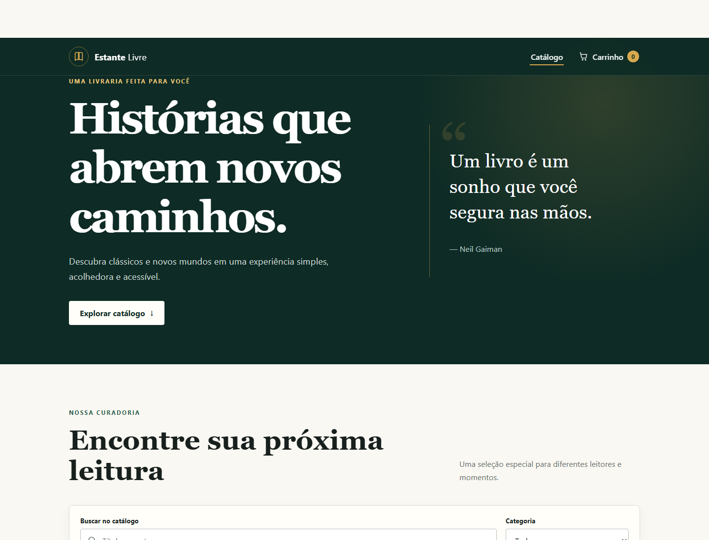

# Projeto Livraria Online — Acessibilidade Web

## 1. Identificação

- **Aluno:** Hugo Porto
- **Projeto:** Estante Livre — Livraria online acessível
- **Atividade:** Parada Obrigatória 2
- **Disciplina:** Desenvolvimento Full Stack
- **Repositório:** [github.com/hugopferraro/Library-Purchase-Cart](https://github.com/hugopferraro/Library-Purchase-Cart)
- **Aplicação publicada:** [library-purchase-cart.vercel.app](https://library-purchase-cart.vercel.app/)

## 2. Descrição do projeto

Estante Livre é uma aplicação React e TypeScript que simula uma livraria online. O usuário pode pesquisar livros, filtrar o catálogo por categoria, adicionar obras ao carrinho, alterar quantidades, remover itens e consultar o total do pedido. O estado do carrinho é gerenciado com Redux Toolkit e preservado no navegador.

A segunda fase substituiu a versão mínima feita com Create React App por uma aplicação profissional criada com Vite, incorporando acessibilidade desde a estrutura semântica até os testes automatizados.

## 3. Análise da aplicação antes das melhorias

A análise inicial foi realizada sobre a versão entregue na primeira fase, antes da reconstrução. A inspeção do código e a navegação manual revelaram os seguintes problemas:

| Problema encontrado | Impacto para o usuário |
| --- | --- |
| Não existia um título principal (`h1`) nas rotas | Leitores de tela não recebiam uma identificação clara da página |
| Interface sem regiões semânticas (`header`, `nav`, `main`) | A navegação por regiões era impossível |
| Botões genéricos em inglês, como “Add to Cart” e “Remove” | O livro acionado não era anunciado e o idioma era inconsistente |
| Alterações do carrinho sem `aria-live` | A pessoa usuária de leitor de tela não recebia confirmação da ação |
| Ausência de imagens e textos alternativos | O requisito de conteúdo visual acessível não era atendido |
| Ausência de estilo de foco planejado e link de salto | A navegação por teclado era pouco orientada e repetitiva |
| Apenas dois produtos fictícios (“Book 1” e “Book 2”) | A demonstração tinha pouca clareza e aparência incompleta |
| Projeto em React 17 com `react-scripts` | Ferramenta descontinuada e diferente da preferência do docente |
| Nenhum teste automatizado | Não havia evidência reproduzível da qualidade funcional ou de acessibilidade |
| Link da aplicação publicada ausente | A entrega não permitia acesso ao sistema em produção |

*Figura 1 — Página inicial da primeira fase, antes das melhorias.*

*Figura 2 — Carrinho da primeira fase, sem estrutura visual ou feedback acessível.*

## 4. Reconstrução técnica

O projeto foi migrado para Vite, React e TypeScript com modo estrito. O Redux tradicional foi substituído por Redux Toolkit, mantendo o gerenciamento de estado global solicitado. O React Router organiza as páginas de catálogo, carrinho e rota não encontrada.

A aplicação passou a oferecer:

- catálogo realista com seis livros;
- busca por título ou autor e filtro por categoria;
- adição, remoção e controle de quantidade entre 1 e 10 unidades;
- cálculo de subtotal e total;
- persistência do carrinho com `localStorage`;
- layout responsivo e fallback para falha no carregamento de capas;
- configuração de rotas compatível com publicação no Vercel.

## 5. Melhorias de acessibilidade implementadas

### 5.1. Estrutura, idioma e títulos

O documento declara `lang="pt-BR"` e utiliza regiões semânticas: cabeçalho, navegação, conteúdo principal, seções, artigos, conteúdo complementar e rodapé. Cada rota possui um único `h1`, seguido de subtítulos em ordem lógica. O título do navegador e a descrição da página foram definidos em português.

### 5.2. Imagens e conteúdo visual

Todas as capas informativas possuem textos alternativos com título e autoria. A miniatura do carrinho usa `alt=""` porque repete informações textuais adjacentes e, nesse contexto, é decorativa. Quando uma imagem externa falha, a interface apresenta uma capa alternativa com nome e autor.

### 5.3. Navegação por teclado e foco

Todos os controles utilizam elementos nativos (`button`, `a`, `input` e `select`), que respondem a Tab, Enter e Espaço. Um link “Pular para o conteúdo” evita a repetição da navegação. O foco visível tem alto contraste e, após a troca de rota, é movido para o conteúdo principal. Nenhum `tabindex` positivo foi utilizado.

### 5.4. Nomes e mensagens acessíveis

Botões repetidos têm nomes que incluem o livro correspondente, como “Adicionar Dom Casmurro ao carrinho”. Controles de quantidade informam a ação e o título. Regiões `aria-live` anunciam adições, total de resultados, quantidade atual e contador global do carrinho.

### 5.5. Contraste, movimento e responsividade

A identidade visual usa verde escuro, creme, branco e dourado, com foco visível independente da cor. A interface mantém legibilidade e alvos de toque adequados em telas menores. A preferência `prefers-reduced-motion` desativa rolagem suave e transições.

*Figura 3 — Nova página inicial com título principal, navegação semântica, busca identificada e contraste reforçado.*

## 6. Processo de qualidade e testes

Foi criada uma esteira única, executada por `npm run quality`, que impede a entrega caso uma etapa falhe:

1. ESLint com regras de TypeScript, React Hooks e `jsx-a11y`;
2. compilação TypeScript em modo estrito;
3. testes unitários e de integração com Vitest e Testing Library;
4. auditoria automática de acessibilidade com axe;
5. build otimizado de produção com Vite.

### 6.1. Resultado automatizado final

Execução realizada em 07/11/2026:

| Verificação | Resultado |
| --- | --- |
| ESLint | Aprovado, zero erros e zero avisos |
| TypeScript estrito | Aprovado |
| Testes automatizados | 7 de 7 aprovados |
| Auditoria axe na página inicial | Nenhuma violação detectada |
| Build de produção | Aprovado, 65 módulos processados |
| Servidor de pré-visualização | HTTP 200 |

Os testes verificam adição sem duplicação, incremento e limite de quantidade, remoção, limpeza do carrinho, filtro do catálogo, fluxo entre catálogo e carrinho e violações automatizáveis de acessibilidade.

### 6.2. Resultado dos testes manuais

Após a publicação, a versão de produção foi inspecionada manualmente. Os itens abaixo foram concluídos:

- [x] Executar Lighthouse em modo incógnito na URL publicada;
- [x] Percorrer catálogo e carrinho usando apenas Tab, Shift+Tab, Enter e Espaço;
- [x] Confirmar a leitura dos títulos, regiões, filtros e mensagens com NVDA;
- [x] Testar zoom de 200% sem perda de conteúdo ou rolagem horizontal indevida;
- [x] Testar larguras de 320 px, 768 px e 1440 px;
- [x] Confirmar que capas e fallbacks são compreensíveis;
- [x] Inserir a URL publicada neste documento e no README.

Os testes manuais não revelaram impedimentos nos fluxos principais. A navegação pelo catálogo e pelo carrinho permaneceu operável por teclado, e a leitura com NVDA confirmou títulos, regiões, controles e mensagens dinâmicas. A auditoria Lighthouse complementou a verificação automática feita com axe durante a esteira de qualidade.

## 7. Relação com as WCAG

| Diretriz | Aplicação no projeto |
| --- | --- |
| 1.1.1 Conteúdo não textual | Textos alternativos e imagens decorativas corretamente ocultadas |
| 1.3.1 Informações e relações | HTML semântico, landmarks e hierarquia de títulos |
| 1.4.3 Contraste mínimo | Paleta com contraste reforçado para texto e controles |
| 1.4.10 Reflow | Layout responsivo para telas estreitas e ampliação |
| 2.1.1 Teclado | Controles nativos e fluxo completo por teclado |
| 2.4.1 Ignorar blocos | Link de salto para o conteúdo principal |
| 2.4.3 Ordem do foco | Ordem natural e foco transferido na mudança de rota |
| 2.4.7 Foco visível | Contorno de foco de três pixels e alto contraste |
| 3.1.1 Idioma da página | Documento identificado como português brasileiro |
| 4.1.2 Nome, função e valor | Rótulos, nomes acessíveis e estados de controles |
| 4.1.3 Mensagens de status | Regiões ao vivo para filtros e operações do carrinho |

## 8. Publicação

O arquivo `vercel.json` redireciona rotas da SPA para `index.html`. No Vercel, a configuração esperada é:

- **Framework:** Vite;
- **Build command:** `npm run build`;
- **Output directory:** `dist`;
- **Install command:** `npm install`.

A versão de produção está disponível em [https://library-purchase-cart.vercel.app/](https://library-purchase-cart.vercel.app/). Após o deploy, a aplicação também foi incluída na etapa de validação manual descrita neste relatório.

## 9. Conclusão

A reconstrução transformou o protótipo mínimo em uma livraria funcional, tipada, responsiva e verificável. A acessibilidade passou a orientar a estrutura, a navegação, o feedback de estado, a apresentação visual e o processo de qualidade. Os testes automatizados aprovados fornecem uma base reproduzível, complementada pela validação manual concluída com Lighthouse, teclado e NVDA na versão publicada.
